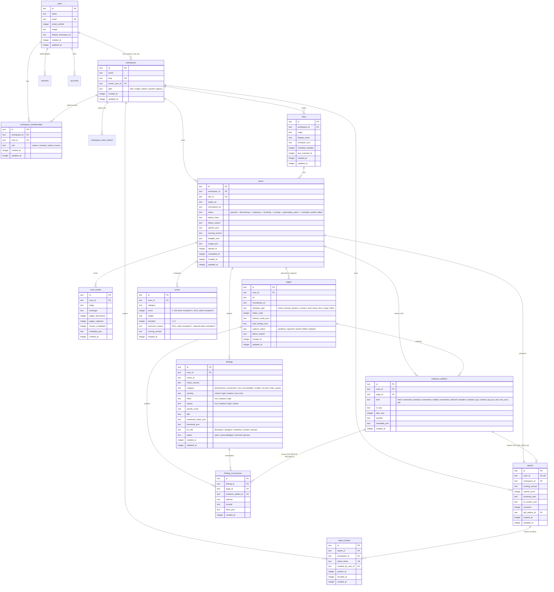

# Mortem Cloudflare D1 Entity-Relationship Diagram

This document is the canonical relational schema reference for Mortem's Cloudflare D1 database (`mortem-db`). It covers both identity/workspace ownership (`0001_auth_and_workspaces.sql`) and the diagnostic crawl, evidence, finding, score, and report pipeline (`0002_scans_evidence_findings_reports.sql`).

## Mermaid ER Diagram

## Key Relational Invariants

1. **Workspace Isolation (`workspace_id`)**:
   Every `sites`, `scans`, `reports`, and `report_shares` row belongs to a `workspaces.id` with `ON DELETE CASCADE`.
2. **Evidence-Backed Findings (`finding_occurrences`)**:
   Every `finding_occurrences` row requires non-null foreign keys to `findings(id)`, `pages(id)`, and `evidence_artifacts(id)` (`ON DELETE RESTRICT` on `evidence_artifact_id` so raw proof in R2/D1 cannot be orphaned while a finding references it).
3. **Provenance-Backed Category Scores (`scores`)**:
   Enforced via SQL `CHECK` constraint and `validateCategoryScoreInput`:
   - When `included = 1`: `score` must be an integer in `[0, 100]` and `exclusion_reason` must be `NULL`.
   - When `included = 0` (partial scan): `score` must be `NULL` and `exclusion_reason` must be a non-empty string explaining why the category was excluded.
